# PiyaNota backend schema (ERD)

Reference for PIYA-311 AC5. The Task 3 SQL migration must match this file column for column.
PostgreSQL on Neon. All `*_at` columns are `timestamptz`. Ids are `bigserial` unless stated.

## Diagram

Types are simplified so GitHub renders the diagram. Full detail is in the tables below.

```mermaid
erDiagram
    users ||--o{ sessions : has
    users ||--o{ password_reset_tokens : has
    users ||--o{ jobs : submits
    users ||--o{ scores : owns
    scores |o--o{ jobs : "completed by"
    jobs ||--o{ job_pages : has
    jobs |o--o| jobs : "replaces"
    scores ||--o{ audio_tracks : has
    scores ||--o| timing_metadata : has

    users {
        bigint id PK
        text email UK
        text password_hash
        text role
        timestamptz deleted_at
    }
    sessions {
        bigint id PK
        bigint user_id FK
        bytea token_hash UK
        timestamptz expires_at
        timestamptz revoked_at
    }
    password_reset_tokens {
        bigint id PK
        bigint user_id FK
        bytea token_hash
        timestamptz expires_at
        timestamptz used_at
    }
    jobs {
        bigint id PK
        bigint user_id FK
        bigint score_id FK
        text status
        text source
        smallint page_count
        text title
        smallint tempo_bpm
        uuid client_submission_id
        bigint replaces_job_id FK
        bigint superseded_by_job_id FK
    }
    job_pages {
        bigint id PK
        bigint job_id FK
        smallint page_index
        text object_key
    }
    scores {
        bigint id PK
        bigint user_id FK
        text title
        smallint page_count
        jsonb review
        timestamptz last_accessed_at
    }
    audio_tracks {
        bigint id PK
        bigint score_id FK
        text voice
        text file_key
    }
    timing_metadata {
        bigint id PK
        bigint score_id FK
        text metadata_key
    }
    throttle_hits {
        bigint id PK
        text bucket
        text subject_key
    }
    throttle_backoff {
        text scope PK
        text subject_key PK
        int failures
    }
    storage_deletions {
        bigint id PK
        text object_key
        int attempts
    }
    purge_log {
        bigint id PK
        bigint user_ref
    }
    schema_migrations {
        text version PK
        timestamptz applied_at
    }
```

`throttle_*`, `storage_deletions`, `purge_log` and `schema_migrations` have no foreign keys.
That is on purpose: they must outlive the rows they refer to and must hold no PII.

The migration (Task 3) chooses all constraint and index names; the names in this file are suggestions.

Only `replaces_job_id` is drawn as a relationship line (the `replaces` line). `superseded_by_job_id` appears as an attribute only.

## Timestamps

Every table with `updated_at` gets it maintained by one shared trigger function `set_updated_at()`, run BEFORE UPDATE. Tables with `updated_at`: users, sessions, password_reset_tokens, jobs, scores, throttle_backoff, storage_deletions.

Insert-only tables have no `updated_at`:

- `throttle_hits`, `purge_log`, `schema_migrations`: append-only logs; rows are never updated.
- `audio_tracks`, `timing_metadata`, `job_pages`: rows are never updated; a change replaces them by delete + insert.

## Shared CHECK values

- **title:** `char_length(title) BETWEEN 1 AND 120`. **arranger:** NULL or `char_length BETWEEN 1 AND 120`.
- **tempo_bpm:** `BETWEEN 30 AND 240`. **tempo_source:** `IN ('user','fallback','default')`.
- **key_signature:** NULL or one of `C G D A E B F# C# F Bb Eb Ab Db Gb Cb` (the 15 values of PIYA-101 AC8).
- **time_signature:** NULL or one of `4/4 3/4 2/4 6/8 2/2`.

## Tables

### users

| Column | Type | Null | Default | Constraint | Ticket |
|---|---|---|---|---|---|
| id | bigserial | no | | PK | PIYA-311 AC1 |
| email | text | no | | UNIQUE; CHECK (`email = lower(btrim(email))`) | PIYA-311 AC1 |
| password_hash | text | no | | | PIYA-311 AC1 |
| role | text | no | `'choir_member'` | CHECK IN (`'choir_member'`,`'choir_director'`) | PIYA-311 AC1 |
| deleted_at | timestamptz | yes | | | PIYA-319 |
| created_at | timestamptz | no | `now()` | | |
| updated_at | timestamptz | no | `now()` | | |

A soft-deleted user (`deleted_at` set) keeps the UNIQUE email until purge. Re-signup with that email returns 409 until the PIYA-319 purge completes (PIYA-307 AC5).

### sessions

| Column | Type | Null | Default | Constraint | Ticket |
|---|---|---|---|---|---|
| id | bigserial | no | | PK | |
| user_id | bigint | no | | FK users(id) ON DELETE CASCADE | |
| token_hash | bytea | no | | UNIQUE; SHA-256 of the token | |
| expires_at | timestamptz | no | | | |
| revoked_at | timestamptz | yes | | | |
| created_at | timestamptz | no | `now()` | | |
| updated_at | timestamptz | no | `now()` | | |

Index: `sessions_user_idx` on `(user_id)`.

Why SHA-256 only: session tokens are long random values, so a fast hash is enough and allows lookup by hash.

### password_reset_tokens

| Column | Type | Null | Default | Constraint | Ticket |
|---|---|---|---|---|---|
| id | bigserial | no | | PK | |
| user_id | bigint | no | | FK users(id) ON DELETE CASCADE | |
| token_hash | bytea | no | | HMAC-SHA256 of the 6-digit code | V2 B4.1 |
| expires_at | timestamptz | no | | | |
| used_at | timestamptz | yes | | | |
| created_at | timestamptz | no | `now()` | | |
| updated_at | timestamptz | no | `now()` | | |

Indexes:

- `password_reset_tokens_user_idx` on `(user_id)`.
- `password_reset_tokens_one_live_idx`: UNIQUE on `(user_id) WHERE used_at IS NULL`. At most one live reset code per user.

Why HMAC: a 6-digit code has only 10^6 values. A plain hash can be brute-forced from a leaked row. The HMAC key stays outside the database.

### jobs

| Column | Type | Null | Default | Constraint | Ticket |
|---|---|---|---|---|---|
| id | bigserial | no | | PK | |
| user_id | bigint | no | | FK users(id) ON DELETE CASCADE | |
| score_id | bigint | yes | NULL until complete | FK scores(id) ON DELETE SET NULL | PIYA-311 AC1 |
| status | text | no | | CHECK IN (`queued`,`preprocessing`,`detecting_staff`,`transcribing`,`reconstructing`,`synthesizing`,`complete`,`failed`,`cancelled`) | PIYA-311 AC1 |
| source | text | no | | CHECK IN (`images`,`pdf`) | |
| page_count | smallint | no | | CHECK BETWEEN 1 AND 20 | |
| title | text | no | | title CHECK | PIYA-311 AC7 |
| arranger | text | yes | | arranger CHECK | PIYA-311 AC7 |
| tempo_bpm | smallint | no | `90` | tempo CHECK | PIYA-311 AC7 |
| tempo_source | text | no | | tempo_source CHECK | PIYA-311 AC7 |
| key_signature | text | yes | | key CHECK | PIYA-311 AC7 |
| time_signature | text | yes | | time CHECK | PIYA-311 AC7 |
| current_page | smallint | yes | | | |
| percent_complete | smallint | no | `0` | CHECK BETWEEN 0 AND 100 | |
| failure_reason | text | yes | | | PIYA-111 |
| failure_page_index | smallint | yes | | | |
| failed_voices | jsonb | no | `'[]'` | | |
| failed_voice_causes | jsonb | no | `'{}'` | | |
| client_submission_id | uuid | yes | | unique with user_id (migration 0002) | PIYA-101 idempotency |
| replaces_job_id | bigint | yes | | FK jobs(id) ON DELETE SET NULL | PIYA-311 AC8 |
| superseded_by_job_id | bigint | yes | | FK jobs(id) ON DELETE SET NULL | PIYA-311 AC8 |
| completed_at | timestamptz | yes | | | |
| created_at | timestamptz | no | `now()` | | |
| updated_at | timestamptz | no | `now()` | | |

Checks: `CHECK (replaces_job_id <> id)` and `CHECK (superseded_by_job_id <> id)`, so a job never points at itself.

Indexes:

- `jobs_one_retake_in_flight`: UNIQUE on `(replaces_job_id) WHERE status NOT IN ('complete','failed','cancelled')`. At most one active retake per job (PIYA-311 AC8).
- `jobs_user_status_idx`: `(user_id, status)`.
- `jobs_score_idx`: `(score_id)`.
- `jobs_superseded_by_idx`: `(superseded_by_job_id)`.
- `jobs_user_client_submission_idx`: UNIQUE on `(user_id, client_submission_id)` (migration 0002). NULLs are distinct, so jobs without a key are unconstrained; a repeat submit with the same key returns the original job.

### job_pages

| Column | Type | Null | Default | Constraint | Ticket |
|---|---|---|---|---|---|
| id | bigserial | no | | PK | |
| job_id | bigint | no | | FK jobs(id) ON DELETE CASCADE | |
| page_index | smallint | no | | CHECK >= 0 | |
| object_key | text | no | | | |
| width | int | no | | CHECK > 0 | |
| height | int | no | | CHECK > 0 | |
| created_at | timestamptz | no | `now()` | | |

UNIQUE `(job_id, page_index)`.

### scores

| Column | Type | Null | Default | Constraint | Ticket |
|---|---|---|---|---|---|
| id | bigserial | no | | PK | |
| user_id | bigint | no | | FK users(id) ON DELETE CASCADE | |
| title | text | no | | title CHECK | PIYA-321 |
| arranger | text | yes | | arranger CHECK | PIYA-321 |
| page_count | smallint | no | | CHECK BETWEEN 1 AND 20 | PIYA-321 |
| tempo_bpm | smallint | no | `90` | tempo CHECK | |
| tempo_source | text | no | | tempo_source CHECK | |
| key_signature | text | yes | | key CHECK | |
| time_signature | text | yes | | time CHECK | |
| thumbnail_key | text | yes | | | |
| review | jsonb | no | | | |
| muted_measures | jsonb | no | `'[]'` | | |
| failed_voices | jsonb | no | `'[]'` | | |
| failed_voice_causes | jsonb | no | `'{}'` | | |
| last_accessed_at | timestamptz | yes | | NULL = never opened | PIYA-308 AC8 |
| created_at | timestamptz | no | `now()` | | |
| updated_at | timestamptz | no | `now()` | | |

Index: `scores_user_idx` on `(user_id)`.

### audio_tracks

| Column | Type | Null | Default | Constraint | Ticket |
|---|---|---|---|---|---|
| id | bigserial | no | | PK | |
| score_id | bigint | no | | FK scores(id) ON DELETE CASCADE | PIYA-311 AC1 |
| voice | text | no | | CHECK IN (`soprano`,`alto`,`tenor`,`bass`) | |
| file_key | text | no | | | deviation 1 |
| created_at | timestamptz | no | `now()` | | |

UNIQUE `(score_id, voice)`.

### timing_metadata

| Column | Type | Null | Default | Constraint | Ticket |
|---|---|---|---|---|---|
| id | bigserial | no | | PK | |
| score_id | bigint | no | | FK scores(id) ON DELETE CASCADE, UNIQUE | PIYA-311 AC1 |
| metadata_key | text | no | | | deviation 1 |
| created_at | timestamptz | no | `now()` | | |

### throttle_hits

| Column | Type | Null | Default | Constraint |
|---|---|---|---|---|
| id | bigserial | no | | PK |
| bucket | text | no | | |
| subject_key | text | no | | HMAC of email, IP or user id. Never the raw value. Lowercase hex HMAC-SHA256 string, 64 chars. |
| created_at | timestamptz | no | `now()` | |

Index: `(bucket, subject_key, created_at)`. It also serves expiry cleanup by `created_at` within a bucket. No FK, so rows survive account deletion without holding PII.

### throttle_backoff

| Column | Type | Null | Default | Constraint |
|---|---|---|---|---|
| scope | text | no | | PK part 1 |
| subject_key | text | no | | PK part 2. Lowercase hex HMAC-SHA256 string (64 chars), never raw. |
| failures | int | no | `0` | |
| last_failure_at | timestamptz | no | | |
| wait_until | timestamptz | yes | | |
| created_at | timestamptz | no | `now()` | |
| updated_at | timestamptz | no | `now()` | |

### storage_deletions

| Column | Type | Null | Default | Constraint |
|---|---|---|---|---|
| id | bigserial | no | | PK |
| object_key | text | no | | |
| attempts | int | no | `0` | |
| next_attempt_at | timestamptz | no | `now()` | |
| last_error | text | yes | | |
| created_at | timestamptz | no | `now()` | |
| updated_at | timestamptz | no | `now()` | |

Index: `storage_deletions_next_attempt_idx` on `(next_attempt_at)`.

A retry queue for B2 deletes. A crash after a DB commit leaves a row here instead of an orphaned file.

### purge_log

| Column | Type | Null | Default | Constraint | Ticket |
|---|---|---|---|---|---|
| id | bigserial | no | | PK | PIYA-319 |
| user_ref | bigint | no | | former `users.id`; no FK, no PII | |
| completed_at | timestamptz | no | | | |
| created_at | timestamptz | no | `now()` | | |

Before the `users` row is deleted (cascade), the purge job queues every page, thumbnail, audio and timing object key of that user in `storage_deletions`, in the same transaction (PIYA-319).

### schema_migrations

| Column | Type | Null | Default | Constraint |
|---|---|---|---|---|
| version | text | no | | PK |
| applied_at | timestamptz | no | `now()` | |

## Lock order

Any transaction that locks both a score and its jobs locks `scores ... FOR UPDATE` first, then `jobs ... FOR UPDATE`, then re-checks job status. This keeps PIYA-309 (delete), V2 B5 (PATCH), PIYA-321 (completion) and PIYA-114 (cancel) deadlock-free.

## Deviations from PIYA-311 AC1

1. `audio_tracks.file_url` became `file_key`, and `timing_metadata.metadata_url` became `metadata_key`. URLs are signed per request (PIYA-308 AC9), so a stored URL would expire. We store the B2 object key.
2. Added tables not in AC1: `sessions` (login tokens), `job_pages` (uploaded page images), `throttle_hits` and `throttle_backoff` (rate limits), `storage_deletions` (delete retry queue), `purge_log` (account purge record), `schema_migrations` (migration runner).
3. `password_reset_tokens.token_hash` is an HMAC, not a plain hash (V2 B4.1; see the table note).
4. Deleting a score also deletes that score's jobs. Their page images are the "score images" PIYA-309 must delete. `jobs.score_id` is ON DELETE SET NULL for safety, so the delete path removes the jobs explicitly, in the same transaction, and queues their `job_pages` keys in `storage_deletions`.
